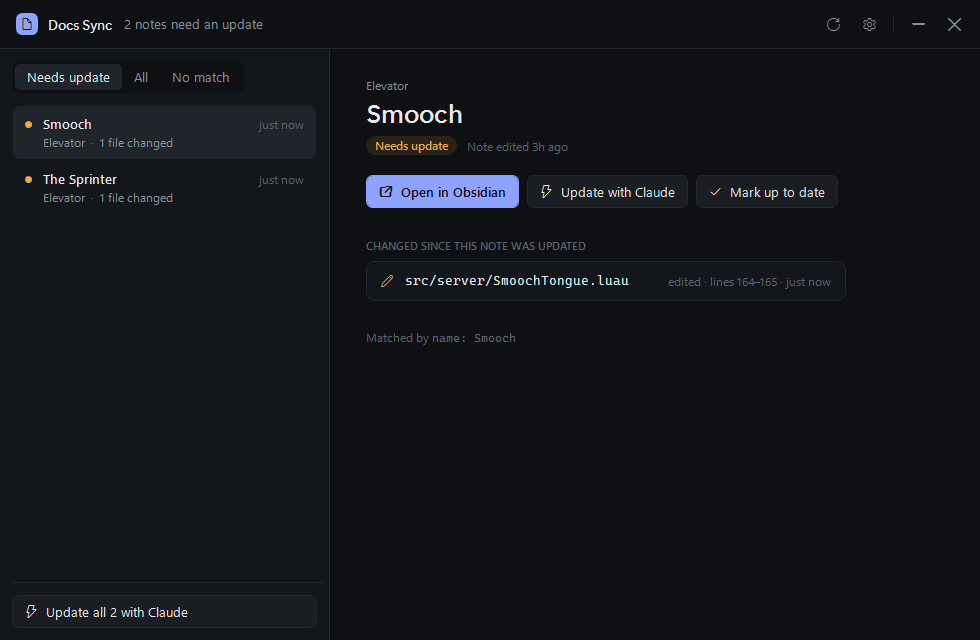
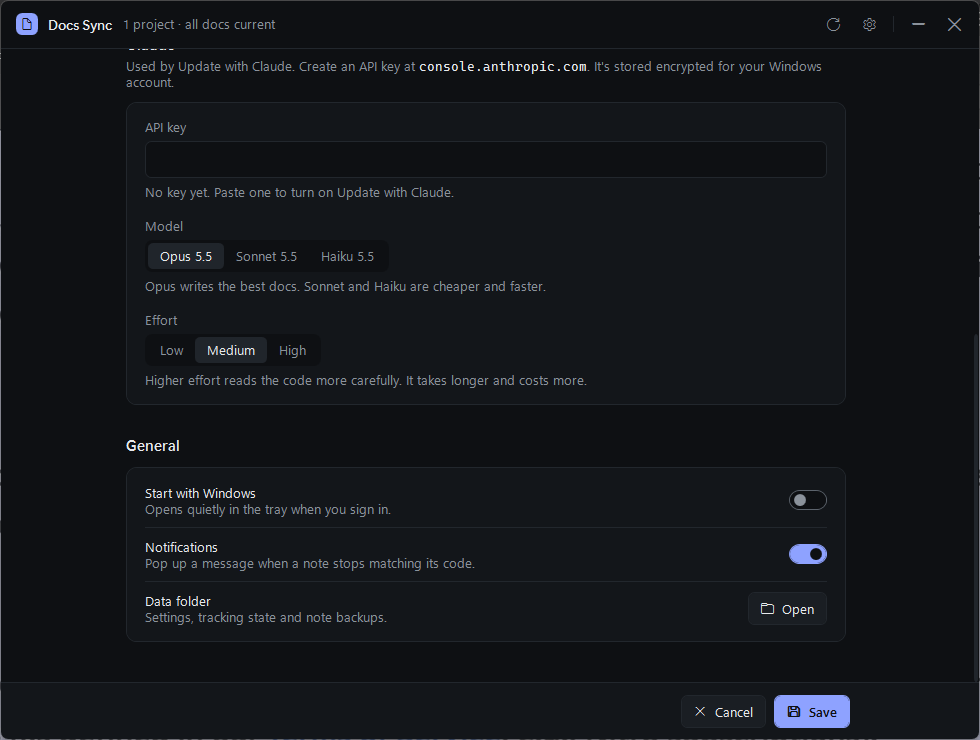

# Docs Sync

A small Windows tray app that tells you when your Obsidian notes no longer match your code, and helps you fix them.



## What it does

- Pairs each project folder with a folder of notes in your vault.
- Links every note to the code it describes, by name (`The Sprinter.md` → `Sprinter.luau`) or by a `covers:` line in the note.
- Watches the code. When a file changes after its note was last edited, the note is flagged, with the changed files, line ranges and added or removed functions.
- **Update with Claude** rewrites the note to match the code and shows you a diff before saving. **Update all** does every flagged note.
- No API key? You get a ready-to-paste prompt for Claude Code or claude.ai instead.

Works with Lua/Luau, C#, Java, Kotlin, Python, JS/TS, Go, Rust, C/C++, Swift, Ruby, PHP, Dart and GDScript. You can add other file types in Settings.

## Install

Download `DocsSync-Setup.msi` from [Releases](../../releases) and run it. It installs for your user only (no admin), adds a Start menu shortcut and starts with Windows. You can turn that off in Settings.

## Set up

1. Open Settings (gear icon).
2. Pick your Obsidian vault.
3. Click **Find projects** and choose the folder that holds your projects, or add projects by hand.
4. Optional: paste an Anthropic API key to turn on **Update with Claude**. It's stored encrypted for your Windows account.



## Linking notes to code

By default a note matches code files whose path contains the note's title. To choose the files yourself, add this to the note's frontmatter:

```yaml
---
covers: [src/server/Sprinter/**, src/shared/SprinterConfig.luau]
---
```

Paths are relative to the project folder. `*` matches within a folder, `**` across folders.

## More

- [Prompt templates](docs/templates.md)
- [Building from source](docs/building.md)

Your data (settings, tracking state, note backups) lives in `%AppData%\DocsSync`.
